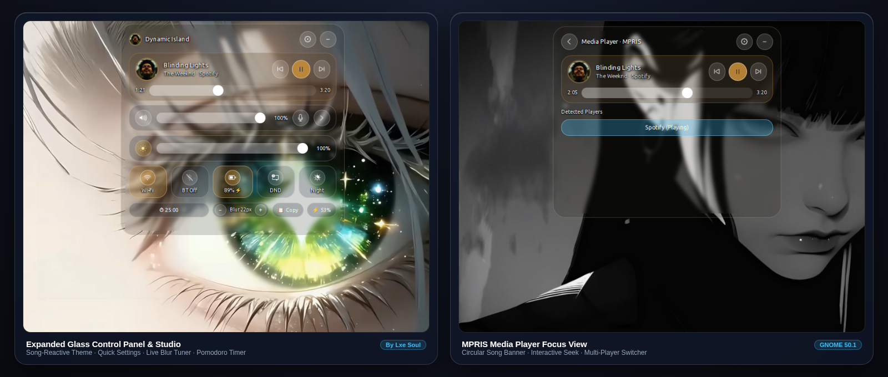
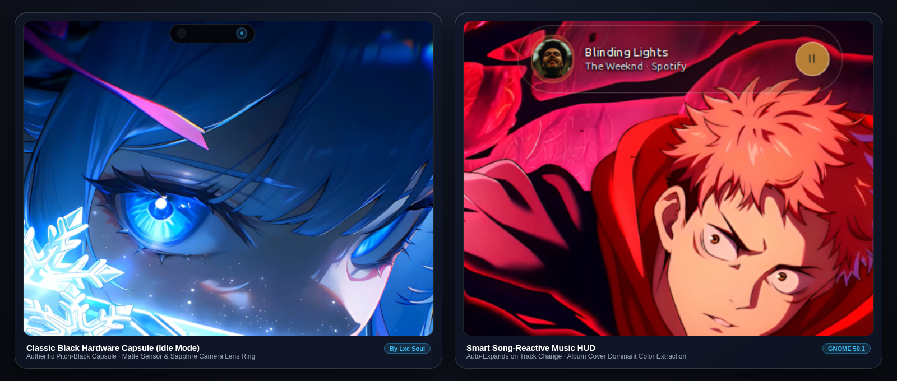
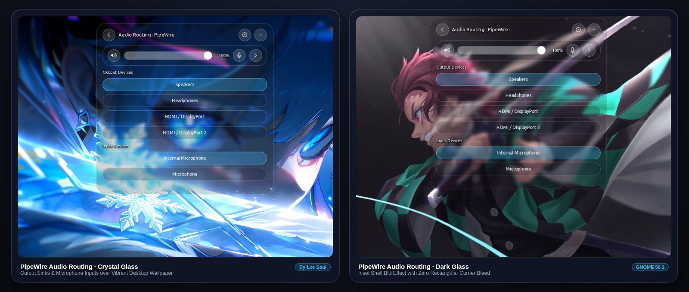

<div align="center">

# GNOME Dynamic Island (`dynamic-island@ubuntu26.gnome.org`)

**By Lxe Soul**

*A production-grade, ultra-transparent glassmorphic **Dynamic Island** extension for **GNOME Shell 50.1** on **Ubuntu 26.04 LTS (Wayland)**, paired with an interactive Web Studio & Desktop Simulator.*

[](#)
[-E95420?style=for-the-badge&logo=ubuntu&logoColor=white)](#)
[](#)
[](#)

</div>

---

## Visual Showcase

> **6 Real Ubuntu 26.04 Captures · Combined into 3 Side-by-Side 2-in-1 Showcase Panels**

### 1. Expanded Glass Control Panel & MPRIS Media Focus View
<p align="center">
  
</p>

> **Left**: Expanded Glass Control Panel featuring song-reactive gold tinting (*The Weeknd — Blinding Lights*), circular album cover banner, scrubbable playback timeline, Master Volume & Display Backlight sliders, 5 Bubble Quick Settings tiles (`Wi-Fi`, `BT`, `89% ⚡`, `DND`, `Night`), and the **Interactive Utility & Blur Studio Bar** (`⏱ 25:00`, `− Blur 22px +`, `📋 Copy`, `⚡ 53%`).  
> **Right**: Dedicated **Media Player · MPRIS** drill-down view with real-time seek slider and multi-player switcher (`Spotify (Playing)`).

---

### 2. Classic Black Hardware Capsule (Idle Mode) & Song-Reactive Music HUD
<p align="center">
  
</p>

> **Left**: When no music or media app is active, the compact island transforms into Apple's iconic pitch-black **Dynamic Island hardware capsule** (`132×30px`) with a matte infrared sensor dot on the left and a dark sapphire camera lens ring on the right—never cluttering your desktop with static volume percentages.  
> **Right**: **Smart Song-Reactive Music HUD** floating pill displaying the circular song banner, track & artist metadata, and an album-tinted play/pause bubble button.

---

### 3. PipeWire Audio Routing · Adaptive Crystal & Dark Glass
<p align="center">
  
</p>

> **Left & Right**: **Audio Output & Input · PipeWire** sub-panel (`Volume.getMixerControl()`) demonstrating real-time sink/source switching (`Speakers · Built-in Audio`, `Headphones · USB-C DAC`, `HDMI / DisplayPort Audio`, `Internal Microphone`) and adaptive background blur across both bright crystal and dark desktop wallpapers.

<details>
<summary><b>📸 View All 6 Individual Full-Resolution Captures</b></summary>
<br />
<table>
  <tr>
    <td align="center" width="50%">
      <br />
      <sub><b>01 · Expanded Glass Control Panel & Utility Bar</b></sub>
    </td>
    <td align="center" width="50%">
      <br />
      <sub><b>02 · Media Player · MPRIS Focus View</b></sub>
    </td>
  </tr>
  <tr>
    <td align="center" width="50%">
      <br />
      <sub><b>03 · Classic Black Hardware Capsule (Idle Mode)</b></sub>
    </td>
    <td align="center" width="50%">
      <br />
      <sub><b>04 · Smart Song-Reactive Music HUD</b></sub>
    </td>
  </tr>
  <tr>
    <td align="center" width="50%">
      <br />
      <sub><b>05 · PipeWire Audio Routing (Crystal Glass)</b></sub>
    </td>
    <td align="center" width="50%">
      <br />
      <sub><b>06 · PipeWire Audio Routing (Dark Glass)</b></sub>
    </td>
  </tr>
</table>
</details>

---

## Highlights & Features

### 1. Classic Black Hardware Capsule (Idle) & Song-Reactive Dynamic Glass
- **Classic Black Idle Mode**: When no song or media session is active, the compact pill displays the iconic pitch-black Apple Dynamic Island hardware capsule (`132×30px`) with a matte infrared sensor dot on the left and a dark sapphire camera lens ring on the right—never cluttering your desktop with static volume text.
- **Song-Reactive Dynamic Theme**: Automatically syncs with **Spotify**, **YouTube** (Firefox / Chrome / Brave / Chromium), and any MPRIS D-Bus media player. Downloads and caches remote (`https://i.scdn.co/...`) or local (`file://`) album artwork, extracts the dominant vibrant RGB palette via `GdkPixbuf`, and dynamically tints the island glass, borders, play button, equalizer bars, and active Quick Settings tiles.
- **Zero-Corner-Bleed Compositor Blur**: Applies native `Shell.BlurEffect` (`Shell.BlurMode.BACKGROUND`, `brightness = 1.0`) to an `8px`-inset inner container so the blur bounding box sits 100% inside the `26px` rounded border arc—preventing rectangular corner artifacts when hovering.

### 2. Circular Song Banner & Interactive Media Controls
- Circular song artwork banner in the Compact pill, Smart HUD notification, Expanded header badge, and Media card.
- Full MPRIS playback controls: Previous, Play/Pause, Next, interactive scrubbable progress `Slider` (`SetPosition`), live timestamps, and multi-player switcher (`Spotify` prioritized automatically).

### 3. Audio Mixer, Display Backlight & Quick Settings
- **Audio Controls (`Gvc.MixerControl`)**: Master volume slider with live percentage, Mute/Unmute, Microphone Mute, and PipeWire Output/Input device routing via `Volume.getMixerControl()`.
- **Display Brightness (`Gsd.Power.Screen`)**: Smooth screen backlight slider and percentage with graceful fallback on external desktop monitors.
- **Quick Settings Grid**: Bubble-styled toggles for **Wi-Fi** (`NetworkManager`), **Bluetooth** (`Gsd.Rfkill` + `BlueZ`), **Battery** (`UPower`), **Do Not Disturb** (`org.gnome.desktop.notifications`), and **Night Light** (`Gsd.Color`).

### 4. Interactive Utility & Blur Studio Bar
- **⏱ Live Pomodoro Focus Timer (`25:00`)**: Start, pause, or reset a 25-minute focus timer right inside the expanded island. When running while collapsed, the compact pill displays the live countdown (`⏱ 24:59`).
- **🌫 Live Blur Tuner (`−` / `Blur XXpx` / `+`)**: Increase or decrease the background blur intensity directly inside the expanded island (`0..60px`) or choose one-click presets (`Off`, `Subtle`, `Medium`, `Strong`) in Preferences.
- **📋 One-Click Copy Track / Stash**: Copies the active song (`Title — Artist`) or system telemetry to the clipboard (`St.Clipboard`) with instant `"✓ Copied"` feedback.
- **⚡ System Pulse (`RAM %` & CPU Load)**: Reads `/proc/meminfo` and `/proc/loadavg` natively on Ubuntu 26.04 with zero subprocess overhead.

### 5. Hold-and-Drag Free Positioning
- Hold the primary mouse button on the island and drag it anywhere on the screen. Coordinates are saved to GSettings (`custom-x`, `custom-y`) without grabbing the global Clutter stage, so top-bar menus and other extensions remain 100% responsive.

---

## Repository Structure

```text
├── docs/screenshots/                         # Combined 2-in-1 visual showcase & raw captures
│   ├── showcase-1-expanded-and-mpris.png     # 2-in-1: Expanded Control Panel + MPRIS View
│   ├── showcase-2-classic-idle-and-hud.png   # 2-in-1: Classic Black Capsule + Music HUD
│   └── showcase-3-pipewire-audio-routing.png # 2-in-1: PipeWire Audio Routing (Light & Dark)
├── extension/                                # Native GNOME Shell 50.1 Extension (ES2022 GJS)
│   ├── metadata.json                         # Extension UUID, GNOME 50 target, schema ID
│   ├── extension.js                          # Main Extension lifecycle (enable / disable)
│   ├── prefs.js                              # GTK4 + Libadwaita Preferences UI
│   ├── stylesheet.css                        # St crystal glass & bubble icon stylesheet
│   ├── schemas/
│   │   ├── org.gnome.shell.extensions.dynamic-island.gschema.xml
│   │   └── gschemas.compiled                 # Pre-compiled GSettings binary schema
│   ├── src/
│   │   ├── islandWidget.js                   # DynamicIslandWidget (Compact, HUD, Expanded, Focus)
│   │   ├── mprisService.js                   # D-Bus MPRIS watcher, artwork cache & GdkPixbuf theme
│   │   ├── audioService.js                   # Gvc.MixerControl PipeWire volume & routing
│   │   ├── brightnessService.js              # Gsd.Power.Screen backlight proxy
│   │   ├── quickSettingsService.js           # NM Wi-Fi, Rfkill BT, UPower, DND, Night Light
│   │   ├── animationController.js            # Clutter spring & ease transitions
│   │   └── utils.js                          # SafeSettings, SignalTracker, TimerRegistry, SongTheme
│   ├── scripts/
│   │   ├── install.sh                        # One-step local installer for Ubuntu 26.04
│   │   ├── pack.sh                           # Builds .shell-extension.zip
│   │   └── uninstall.sh                      # Clean uninstaller
│   ├── README.md
│   ├── TROUBLESHOOTING.md
│   ├── DEPENDENCIES.md
│   └── COMPATIBILITY_REPORT.md
├── public/
│   └── dynamic-island@ubuntu26.gnome.org.shell-extension.zip  # Pre-built installable ZIP
├── src/                                      # Interactive Web Studio & Wayland Desktop Simulator
├── scripts/
│   └── build-extension-bundle.mjs            # ESM syntax, GNOME 50 API & schema audit + ZIP builder
└── tests/
    └── extension-validation.test.ts          # Automated unit & extension audit test suite
```

---

## Quick Installation on Ubuntu 26.04 LTS (GNOME Shell 50.1)

### Method A: Install Pre-Built ZIP Package

```bash
gnome-extensions install --force public/dynamic-island@ubuntu26.gnome.org.shell-extension.zip
```

Log out and log back into your Ubuntu Wayland session, then enable:

```bash
gnome-extensions enable dynamic-island@ubuntu26.gnome.org
```

### Method B: Install Directly from `extension/` Source

```bash
cd extension
chmod +x scripts/*.sh
./scripts/install.sh
```

### Open Preferences

```bash
gnome-extensions prefs dynamic-island@ubuntu26.gnome.org
```

---

## Web Studio & Automated Verification

This repository includes an interactive React + TypeScript + Tailwind CSS Web Studio that simulates the Ubuntu 26.04 Wayland desktop, previews GSettings changes live, and packages the `.shell-extension.zip`.

```bash
# Install dependencies
npm install

# Rebuild the extension snapshot & .shell-extension.zip and run the GNOME 50 audit
node scripts/build-extension-bundle.mjs

# Run the unit & schema validation test suite
npx tsx --test tests/extension-validation.test.ts

# Start the interactive Web Studio on http://localhost:3000
npm run dev
```

---

## Author & Credits

- **Created & Engineered**: **By Lxe Soul**
- **UUID**: `dynamic-island@ubuntu26.gnome.org`
- **License**: MIT
