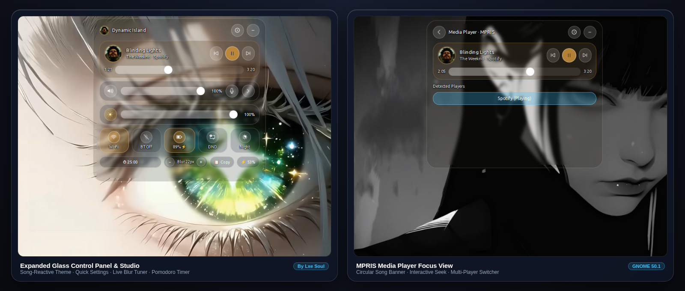
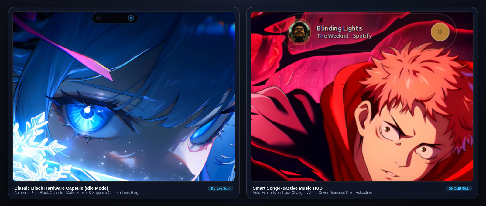
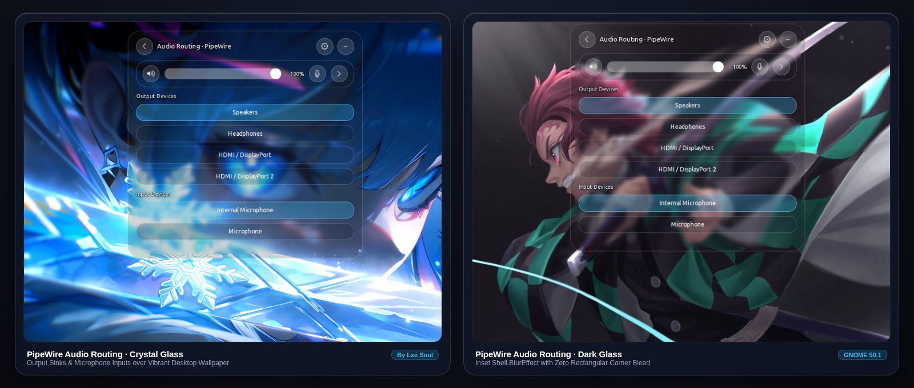

<div align="center">

# GNOME Dynamic Island

**By Lxe Soul**

*A native, modular **GNOME Shell 50.1** extension for **Ubuntu 26.04 LTS (Wayland)** featuring an ultra-transparent floating glassmorphism interface, classic pitch-black hardware capsule idle mode, song-reactive dynamic color theming, circular album banner icons, and an interactive Productivity & Blur Studio.*

</div>

Built with pure GJS ES Modules (`Extension` / `ExtensionPreferences`), native `St` / `Clutter` actors, inset `Shell.BlurEffect`, `GdkPixbuf` album cover color extraction, `Gvc.MixerControl` via GNOME Shell's shared mixer singleton, MPRIS over D-Bus, and Libadwaita (`Adw`) preferences.

---

## Visual Showcase (2-in-1 Combined Panels)

### 1. Expanded Glass Control Panel & MPRIS Media Focus View
<p align="center">
  
</p>

### 2. Classic Black Hardware Capsule (Idle Mode) & Song-Reactive Music HUD
<p align="center">
  
</p>

### 3. PipeWire Audio Routing · Adaptive Crystal & Dark Glass
<p align="center">
  
</p>

---

## Key Features

### 1. Classic Black Hardware Capsule (Idle) & Song-Reactive Dynamic Glass
- **Classic Black Idle Mode**: When no music or media app is active, the compact island transforms into Apple's iconic pitch-black Dynamic Island hardware capsule (`132×30px`) complete with a matte infrared sensor dot on the left and a dark sapphire camera lens ring on the right.
- **Song-Reactive Dynamic Theme**: When Spotify, YouTube, Firefox, Chromium, or any MPRIS player is active, the island automatically downloads/caches the track cover art (`https://`, `file://`, or `data:image/`), samples its vibrant dominant color via `GdkPixbuf`, and tints the glass surface, borders, play button, equalizer bars, and active Quick Settings tiles to match the song.
- **Zero-Corner-Bleed Compositor Blur**: Attaches `Shell.BlurEffect` (`Shell.BlurMode.BACKGROUND`, `brightness = 1.0`) to an `8px`-inset inner container so the blur bounding box stays 100% strictly inside the `26px` rounded border arc—preventing rectangular corner artifacts on hover.

### 2. Circular Song Banner & MPRIS Media Controls
- Displays circular album cover banners in the Compact pill, Smart HUD notification, Expanded header badge, and Media section.
- Interactive playback controls: Previous, Play/Pause, Next, scrubbable progress `Slider` (`SetPosition`), live timestamps, and multi-player switcher (`Spotify` prioritized automatically).

### 3. Audio Mixer, Display Brightness & Quick Settings
- **Audio Controls**: Master volume `Slider` with percentage, Mute/Unmute, Microphone Mute, and PipeWire Output/Input device routing (`Volume.getMixerControl()`).
- **Brightness**: Smooth display backlight `Slider` + percentage (`org.gnome.SettingsDaemon.Power.Screen`), gracefully handling external desktop monitors.
- **Quick Settings**: Wi-Fi (NetworkManager), Bluetooth (`Gsd.Rfkill` + BlueZ), Battery (`UPower`), Do Not Disturb (`org.gnome.desktop.notifications`), and Night Light (`Gsd.Color`).

### 4. Interactive Utility & Blur Studio Bar
- **⏱ Live Pomodoro Focus Timer (`25:00`)**: Start, pause, or reset a 25-minute focus timer right inside the island; when running while collapsed, the compact pill displays the live countdown.
- **🌫 Live Blur Tuner (`−` / `Blur XXpx` / `+`)**: Increase or decrease the background blur intensity directly inside the expanded island (or use the quick presets in Preferences).
- **📋 One-Click Copy Track / Stash**: Copies the currently playing track (`Title — Artist`) or system telemetry to the clipboard with instant `"✓ Copied"` feedback.
- **⚡ System Pulse (`RAM %` & CPU Load)**: Reads `/proc/meminfo` and `/proc/loadavg` natively with zero subprocess overhead.

### 5. Hold-and-Drag Free Positioning
- Hold the primary mouse button on the island and drag it anywhere on your monitor; coordinates are saved automatically to GSettings (`custom-x`, `custom-y`) without grabbing the global Clutter stage.

---

## Installation (Ubuntu 26.04 LTS / GNOME Shell 50.1)

### Option 1: Install from Pre-Packaged ZIP (Recommended)

```bash
gnome-extensions install --force dynamic-island@ubuntu26.gnome.org.shell-extension.zip
```

Log out and log back in (required by GNOME Shell on Wayland when installing a new extension), then enable:

```bash
gnome-extensions enable dynamic-island@ubuntu26.gnome.org
```

### Option 2: Install from Source Repository

```bash
git clone https://github.com/LxeSoul/gnome-dynamic-island.git
cd gnome-dynamic-island/extension
chmod +x scripts/*.sh
./scripts/install.sh
```

### Opening Preferences

```bash
gnome-extensions prefs dynamic-island@ubuntu26.gnome.org
```

Or **right-click** anywhere on the Dynamic Island pill, or click the **⚙ Settings** bubble button in the expanded header.

---

## Author & License

- **Author**: **By Lxe Soul**
- **Target**: Ubuntu 26.04 LTS · GNOME Shell 50.1 (Wayland & X11)
- **License**: MIT License
